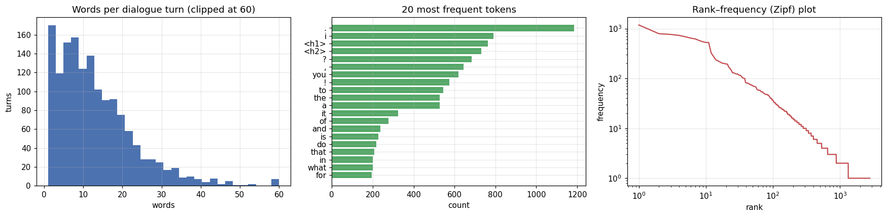
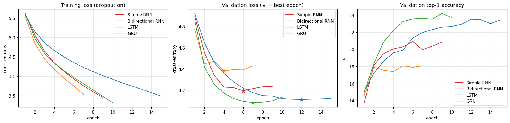
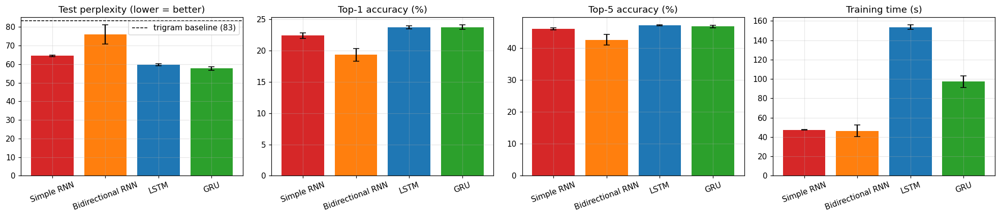
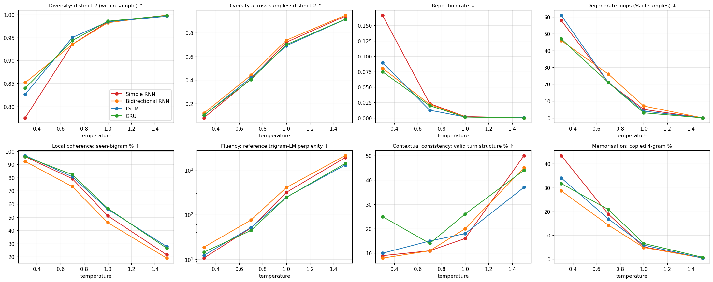

# ChatGen-RNN: Autoregressive Text Generation with Simple RNN, Bidirectional RNN, LSTM and GRU

Foundations of Generative AI (ICT4403) — Assignment 2

## 1. Problem statement and objective
Build a **word-level autoregressive text-generation system** that predicts the next word of a conversation and generates text one word at a time from a seed sequence. Four recurrent architectures — **Simple RNN, Bidirectional RNN, LSTM and GRU** — are trained under identical experimental conditions and compared

* quantitatively: loss, perplexity, top-1 / top-5 accuracy and training time, and
* qualitatively and with automatic proxies: coherence, diversity, contextual consistency and repetition of generated text,

then the influence of the **sampling temperature** is analysed (T = 0.3, 0.7, 1.0, 1.5) and the most effective model is selected.

## 2. Dataset
* **Name:** Human Conversation Training Data — file `human_chat.txt`
* **Source:** <https://www.kaggle.com/datasets/projjal1/human-conversation-training-data>
* A copy is stored in `data/human_chat.txt` so the notebook runs out of the box. (I did not check the dataset's licence terms; if in doubt, delete the copy and download it from the link above into `data/`.)

| Property | Value |
|---|---|
| Content | informal two-person chit-chat (weekend plans, hobbies, food, work, travel) |
| Format | one dialogue turn per line, prefixed `Human 1:` / `Human 2:` |
| Size | 113 KB, 1,494 turns (764 by Human 1, 730 by Human 2) |
| Turn length | mean 13.1 words, median 11, max 151 |
| Tokens | about 24,000 (2,789 unique before pruning) |
| Noise | 133 non-ASCII characters, mostly emojis (removed); conversations are concatenated with no separator |

**Pre-processing:** normalise curly quotes, drop emojis, replace `Human 1:` / `Human 2:` with special tokens `<h1>` / `<h2>` (so the model can learn turn-taking), lower-case, tokenise into words (keeping contractions), digits and `. , ! ?`, collapse repeated punctuation. The token stream is split **chronologically 80 / 10 / 10 %** into train / validation / test; the vocabulary is built **from the training split only** (words seen fewer than 2 times become `<unk>`), giving 1,144 tokens. Each sample is a **sliding window of 12 tokens (stride 1) whose target is the next token**: 19,212 training, 2,391 validation and 2,392 test sequences.



## 3. Models
Common pipeline: `Embedding(1144, 128) -> recurrent layer -> Dropout(0.3) -> Dense(1144)`.

| Model | Recurrent layer | Parameters |
|---|---|---|
| Simple RNN | `SimpleRNN(256)` | 539,000 |
| Bidirectional RNN | `Bidirectional(SimpleRNN(256))` (reads the *context window* both ways; it never sees the word being predicted, generation is still left-to-right) | 930,424 |
| LSTM | `LSTM(256)` | 834,680 |
| GRU | `GRU(256)` | 736,888 |

**Identical training conditions:** Adam (lr 1e-3, gradient clipping 1.0), batch size 128, sparse categorical cross-entropy, at most 40 epochs with early stopping on validation loss (patience 3, best weights restored), same data and seeds. Each model is trained with **3 seeds (42, 43, 44)**; the seed-42 models are used for text generation.

## 4. How to run
```bash
git clone <this-repo-url> && cd <repo>
python -m venv .venv && source .venv/bin/activate      # Windows: .venv\Scripts\activate
pip install -r requirements.txt
jupyter notebook notebooks/autoregressive_text_generation.ipynb   # then Run All
```
* Works on CPU; the full run (12 trainings + generation) took about 20 minutes on a single-vCPU machine.
* **Quick smoke test (a few minutes):** set `QUICK_RUN=1` in the environment before starting Jupyter (macOS/Linux: `QUICK_RUN=1 jupyter notebook`; Windows PowerShell: `$env:QUICK_RUN=1; jupyter notebook`). Results from this mode are not meaningful.
* Tested with Python 3.12 and TensorFlow 2.21 (CPU). Re-running will not reproduce the numbers below bit-for-bit (floating-point differences between machines); training times depend on your hardware.
* Outputs are written to `results/` (tables, figures, generated samples) and `models/` (seed-42 models).

## 5. Results
Mean ± std over 3 seeds, held-out **test** split. Perplexity = exp(cross-entropy per token). Baselines on the same targets: unigram 148.2, interpolated trigram 83.4.

| Model | Params | Epochs run | Train time (s) | Sec/epoch | Test loss | Test perplexity | Top-1 acc (%) | Top-5 acc (%) | Train ppl |
|---|---|---|---|---|---|---|---|---|---|
| Simple RNN | 539,000 | 9.0 ± 0.0 | 47 ± 0 | 5.0 ± 0.0 | 4.166 ± 0.007 | 64.4 ± 0.5 | 22.42 ± 0.44 | 45.96 ± 0.31 | 41.5 ± 0.5 |
| Bidirectional RNN | 930,424 | 6.3 ± 0.6 | 46 ± 6 | 6.8 ± 1.0 | 4.328 ± 0.069 | 75.9 ± 5.2 | 19.36 ± 1.02 | 42.53 ± 1.72 | 58.2 ± 7.1 |
| LSTM | 834,680 | 15.0 ± 0.0 | 153 ± 2 | 10.1 ± 0.2 | 4.089 ± 0.011 | 59.7 ± 0.6 | 23.75 ± 0.22 | 47.06 ± 0.15 | 37.2 ± 0.7 |
| GRU | 736,888 | 9.3 ± 0.6 | 97 ± 6 | 10.1 ± 0.0 | 4.055 ± 0.017 | 57.7 ± 1.0 | 23.77 ± 0.37 | 46.73 ± 0.39 | 37.0 ± 3.2 |

*Train time = wall-clock seconds of `model.fit` including early stopping, measured on a single-vCPU machine. Train ppl is measured on the training split in inference mode at the early-stopped checkpoint.*




Raw numbers: `results/results_all_runs.csv`, `results/results_summary_table.csv`, `results/training_history.csv`.

## 6. Model comparison and evaluation
All numbers are mean ± std over 3 training seeds on the held-out test split. Reference points: the unigram baseline has perplexity 148.2 and the interpolated trigram baseline 83.4.

* **The gated models win.** GRU (test perplexity 57.7) and LSTM (59.7) are clearly better than the Simple RNN (64.4) and the Bidirectional RNN (75.9). Their top-1 accuracies are 23.8 % and 23.8 % versus 22.4 % and 19.4 %. All four neural models beat the trigram baseline.
* **GRU vs LSTM is close.** Top-1 accuracy is identical (23.77 % vs 23.75 %), top-5 is within 0.4 points, and GRU's perplexity is about 2 points lower. With only 3 seeds and a gap of roughly 1–2 standard deviations, this is *modest* evidence for GRU, not a decisive win. GRU does reach its best validation loss much sooner (epoch 6–7 vs about 12), so it needs 97 s of training against 153 s for LSTM, with 12 % fewer parameters (737 k vs 835 k). The per-epoch cost is the same (10.1 s) on this CPU, so the saving comes from faster convergence.
* **Simple RNN** is a respectable baseline but its validation loss turns upward after epoch 6, and it ends about 12 % higher in perplexity than GRU.
* **Bidirectional RNN is the weakest and least stable** (perplexity 75.9 ± 5.2, best epoch only 3–4). Its validation loss starts rising almost immediately while training loss keeps falling fastest. Reading a *left-context* window backwards adds no information that a forward pass lacks for left-to-right prediction, yet it doubles the recurrent parameters (930 k in total) and makes overfitting easier on a 24 k-token corpus.

## 7. Sampling-temperature analysis
Five hand-written seeds (weekend, travel, work, tiredness, food; all words in the vocabulary) were continued for 40 tokens by every model at T = 0.3, 0.7, 1.0 and 1.5, with 20 samples per seed, using the same random stream for every model at a given T. At each step the logits are divided by T, `<pad>` and `<unk>` are never sampled, and one token is drawn.

Metric definitions: **distinct-2** = share of unique bigrams inside a sample (diversity; "across" = pooled over all samples); **repetition rate** = 1 − distinct-3; **loops %** = samples where a bigram occurs ≥ 3 times or a token repeats ≥ 3 times in a row; **seen-bigram %** = generated bigrams that occur in the training text (local coherence); **ref. ppl** = perplexity of the generated text under an independent trigram language model (fluency, lower is better); **valid turns %** = samples in which speaker tags strictly alternate with no empty turn (real text: about 93 %); **copied 4-gram %** = generated 4-grams found verbatim in the training set (memorisation).

| T | Model | distinct-2 | distinct-2 (across) | repetition rate | loops % | seen-bigram % | ref. ppl | valid turns % | copied 4-gram % |
|---|---|---|---|---|---|---|---|---|---|
| 0.3 | Simple RNN | 0.775 | 0.081 | 0.167 | 58.0 | 95.9 | 10.6 | 9.0 | 43.5 |
| 0.3 | Bidirectional RNN | 0.852 | 0.121 | 0.081 | 46.0 | 92.3 | 18.6 | 8.0 | 28.7 |
| 0.3 | LSTM | 0.826 | 0.103 | 0.090 | 61.0 | 96.8 | 12.2 | 10.0 | 34.1 |
| 0.3 | GRU | 0.840 | 0.105 | 0.075 | 47.0 | 96.0 | 14.4 | 25.0 | 31.8 |
| 0.7 | Simple RNN | 0.935 | 0.409 | 0.023 | 21.0 | 79.2 | 50.3 | 11.0 | 18.9 |
| 0.7 | Bidirectional RNN | 0.935 | 0.441 | 0.022 | 26.0 | 73.2 | 75.5 | 11.0 | 14.2 |
| 0.7 | LSTM | 0.950 | 0.421 | 0.012 | 21.0 | 80.7 | 51.3 | 15.0 | 16.8 |
| 0.7 | GRU | 0.944 | 0.404 | 0.020 | 21.0 | 82.3 | 44.2 | 14.0 | 20.8 |
| 1.0 | Simple RNN | 0.984 | 0.720 | 0.002 | 5.0 | 51.1 | 315.4 | 16.0 | 5.0 |
| 1.0 | Bidirectional RNN | 0.982 | 0.737 | 0.002 | 7.0 | 45.9 | 404.9 | 20.0 | 4.8 |
| 1.0 | LSTM | 0.984 | 0.691 | 0.002 | 4.0 | 56.1 | 246.0 | 18.0 | 5.8 |
| 1.0 | GRU | 0.986 | 0.699 | 0.001 | 3.0 | 56.8 | 243.7 | 26.0 | 6.5 |
| 1.5 | Simple RNN | 0.999 | 0.939 | 0.000 | 0.0 | 21.5 | 1901.5 | 50.0 | 0.4 |
| 1.5 | Bidirectional RNN | 0.999 | 0.947 | 0.000 | 0.0 | 19.0 | 2106.6 | 45.0 | 0.4 |
| 1.5 | LSTM | 0.996 | 0.912 | 0.000 | 0.0 | 27.8 | 1298.2 | 37.0 | 0.3 |
| 1.5 | GRU | 0.998 | 0.914 | 0.000 | 0.0 | 26.6 | 1400.8 | 44.0 | 0.7 |



**Excerpts** (seed: *"Human 1: hi! how was your weekend? Human 2: it was great, i went to a movie with my friends. Human 1: that sounds ..."*; `‖` = change of speaker; excerpts shortened; the first three samples for every seed, model and temperature are in `results/generated_samples.md`):

* **T = 0.3, Simple RNN:** *good! what are you have to do you? ‖ Human 2: i am like a lot of the world. ‖ Human 1: hi! ‖ Human 2: hi! ‖ Human 2: hi! ‖ Human 2: hi! ...*
* **T = 0.7, GRU:** *good! i also know ‖ Human 1: hi! ‖ Human 2: hello. how is your day going? ‖ Human 1: pretty good! i feel like my day. ...*
* **T = 1.0, LSTM:** *good! i think would also it. how do you like to finish? ‖ Human 1: thanks, visiting ml i've come? ‖ Human 2: i need to start hawaii. ...*
* **T = 1.5, GRU:** *sounds awesome too! what sense nice any friends area doing keep your plans? ‖ Human 2: so hey! looking love from today,, admit fully ...*

Averaged over 5 seeds x 20 samples x 40 generated tokens per model and temperature (see the table in the README / notebook section 7.1):

* **T = 0.3 (very conservative).** The text is locally the most fluent (92–97 % of bigrams occur in the training text, reference perplexity 11–19) but it is dominated by repetition and mode collapse. 46–61 % of samples contain a loop, typically the *greeting attractor* ("hi! / Human 2: hi! / Human 2: hi! ..."; about 12 % of all turns in the file start with hi / hello / hey and conversations typically open with one, so a greeting is a very probable continuation). 29–44 % of 4-grams are copied verbatim from the training set, and distinct-2 *across* samples is only 0.08–0.12: different seeds produce nearly the same text. The Simple RNN has the highest repetition rate (0.167) and the most copied 4-grams (43.5 %); the LSTM has the most looping samples (61 %).
* **T = 0.7 (best compromise).** Loops drop to 21–26 % of samples, the repetition rate to at most 0.023, within-sample distinct-2 rises to at least 0.935 and across-sample diversity to about 0.40–0.44, while 73–82 % of bigrams are still seen in training and the reference perplexity stays at 44–76. The output consists of plausible short phrases ("hello. how is your day going?") but sentences drift and break down.
* **T = 1.0 (the model's own distribution).** Repetition has practically vanished (rate <= 0.002, loops 3–7 %) but fluency has collapsed to word salad with rare content words dropped in at random ("kayaking", "hawaii", "pikachu"): seen-bigram falls to 46–57 % and reference perplexity to 244–405.
* **T = 1.5.** Effectively random text (seen-bigram 19–28 %, reference perplexity 1,300–2,100, distinct-2 about 1.0). Not usable.
* **Contextual consistency is poor everywhere.** In the roughly 70 samples I read (seeds 0, 2 and 3: weekend, work, tiredness, at several temperatures) no model continued the topic of its seed; the 12-token window and a 24 k-token corpus are not enough to carry a topic. Turn structure is also weak: speaker tags alternate correctly in only 8–26 % of samples at T <= 1.0, against about 93 % for real text windows of the same kind. The *rise* of this metric at T = 1.5 is an artefact: high-temperature samples contain fewer speaker tags (about 1.6 per sample vs about 4.4 at T <= 0.7, counted in the 60 saved samples per temperature), so there is less opportunity to break the alternation. It should not be read as better consistency.
* **Temperature matters more than architecture** for diversity and repetition: from T = 0.7 upwards the four models are within about 0.02 of each other on within-sample distinct-2, and their repetition rates are all below 0.025; they differ mainly in fluency (below). Only at T = 0.3 do the architectures separate on diversity (distinct-2 from 0.775 for the Simple RNN to 0.852 for the Bidirectional RNN).

#### Which model generates best?

At T = 0.7 the **GRU** has the lowest reference perplexity (44.2, vs 50.3 Simple RNN, 51.3 LSTM, 75.5 Bidirectional RNN) and the highest share of seen bigrams (82.3 %). At T = 1.0 GRU and LSTM are tied (243.7 vs 246.0) and clearly ahead of the Simple RNN (315.4) and Bidirectional RNN (404.9). The Bidirectional RNN is the least fluent at every temperature >= 0.7. These generation metrics are proxies, and the differences between GRU and LSTM are small; in the samples I read, GRU and LSTM tended to give the more grammatical phrases and the Simple/Bidirectional RNNs more word salad (an impression from a limited set of samples, not a measured result), and all four models are weak at long-range coherence.

## 8. Conclusion
The **GRU** is the most effective autoregressive generator for this dataset, with the **LSTM a very close second**. The GRU has the best test perplexity (57.7 ± 1.0) and top-1 accuracy (23.77 %, tied with the LSTM), the best fluency under temperature sampling at T = 0.7, and it needs roughly two-thirds of the LSTM's training time (97 s vs 153 s) and has fewer parameters. The ranking by perplexity is GRU < LSTM < Simple RNN < Bidirectional RNN, and the best sampling setting is a temperature of about 0.7 (T = 0.3 repeats, T >= 1.0 loses coherence).

**Caveats.** The GRU-vs-LSTM gap is small relative to seed-to-seed variation, so the safest reading is "gated units clearly beat plain RNNs; GRU is at least as good as LSTM and cheaper to train". The corpus is tiny (24 k tokens), so no model produces topic-coherent dialogue; perplexity includes `<unk>` targets (6.6 % of training and 13 % of validation/test tokens), so the absolute values are not comparable with other corpora; the automatic generation metrics are proxies; and the qualitative comments come from one reader's inspection of the saved samples. Training times were measured on a single-vCPU CPU environment and will differ on other hardware.

## 9. Repository structure
```
.
├── README.md
├── requirements.txt
├── data/human_chat.txt                         # dataset copy (source link above)
├── notebooks/autoregressive_text_generation.ipynb   # full implementation, executed, with outputs
├── models/                                     # trained seed-42 models (.keras)
├── results/
│   ├── results_summary_table.csv, results_summary_mean_std.csv, results_all_runs.csv, training_history.csv
│   ├── generation_metrics.csv, generated_samples.md
│   └── fig_*.png                               # dataset overview, training curves, test metrics, temperature effects
└── submission/                                 # Word document template for the LMS submission
```
